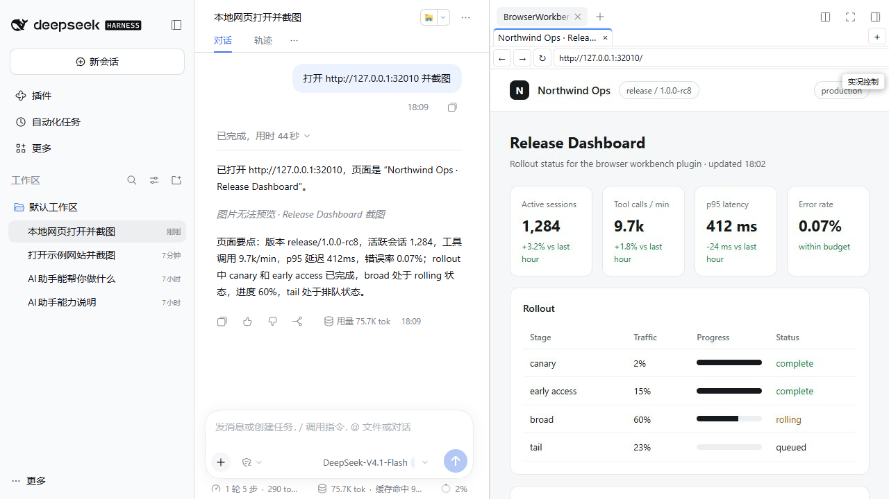
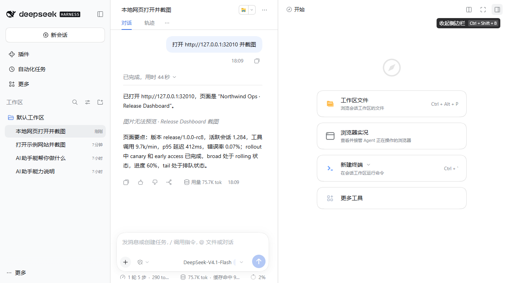
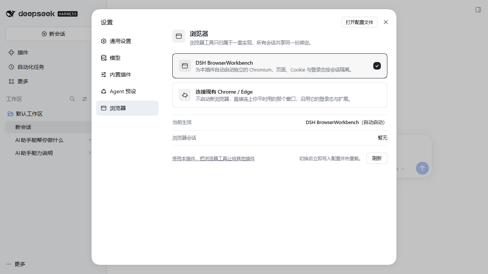
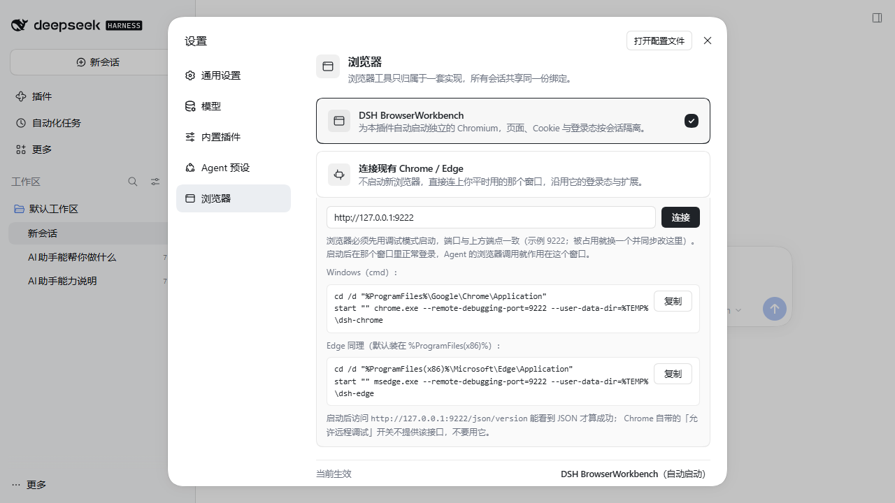

<div align="center">

# DSH BrowserWorkbench

### Hand your DSH agent a working Chromium debugging workbench

Not just a viewer. It clicks, sets breakpoints, captures requests, resolves Source Maps — and keeps the evidence.


[Install from source](#installation) · [See it work](#what-it-looks-like) · [30 tools](#feature-reference) · [Verification](#verification-results) · [Technical details](./TECHNICAL.en.md) <br> <br>
English | [简体中文](./README.md)

</div>

---

> [!IMPORTANT]
> This is an independently developed community plugin. It is not published, maintained, or endorsed by DeepSeek, and it does not modify DeepSeek Harness core code.<br>
> The current version is `1.0.0-rc8` and **has not been published to npm yet** (see [PUBLISHING.md](./PUBLISHING.md)). Use the [source-install](#installation) flow below.<br>
> The project is still under active development — file an issue for bugs or anything unexpected.
>
>> *If this plugin saves you time, a star helps others find it. Thanks!*

## Current status

| Item | Reality |
| --- | --- |
| Version | `1.0.0-rc8` (release candidate) |
| Target host | DSH `0.2.1-rc.2` / `0.2.1-rc.3`, declared as the peer range `^0.2.1-rc.2 \|\| ^0.2.1-rc.3`; Cordis `~4.0.5`, Schemastery `~3.18.5` |
| npm status | **Not published.** The first release has not been made; installing from npm does not work yet |
| Repository contents | Source, tests, docs; **no** `lib/` build output, no `node_modules`, `.sandbox`, or `.npm-cache` |
| Verified | Strict typecheck, 178 unit tests, production build, 30-tool regression against real Chromium, layered verification in a separate process with its own `DSH_HOME` |
| Still pending | Rewriting the panel and RPC e2e scripts for the new UI; manual install/launch/auth/uninstall acceptance on a brand-new DSH Web profile; first npm release |
| Not claimed | DSH `0.1.x` hosts, macOS/Linux hardware, third-party browser plugins |

## What this plugin is

Front-end debugging hurts because you cannot see the page structure, cannot see the request details, cannot get a breakpoint to land, and the error is one line of text. Agents have it worse on a complex page: they can take a screenshot, describe it, and then get stuck in a loop of "try reloading" and "try clearing the cache".

BrowserWorkbench puts a working browser in the DSH Web sidebar and ships 30 purpose-built automation tools. The panel is deliberately thin: a tab strip, an address bar (back / forward / reload), the real page live, and human takeover. Eight former views — Console, Network, Debugger, Performance, Emulation, Diagnostics, Provider, and Extensions — are gone from the panel, because those capabilities belong to the agent: they are all served by the `browser_*` tools (`browser_console_messages`, `browser_network_requests`, `browser_debugger`, `browser_profile`, `browser_diagnose`, `browser_emulate`, and friends) instead of a hand-built UI clone. The agent reads page structure, drives elements, reads the Console, traces requests, sets breakpoints, walks call stacks, resolves Source Maps, profiles performance, and records the full scene before and after an operation.

**The entry point is the Start page of the right sidebar**: the plugin registers a `guide` entry with `sidebarRightTabs`, so the sidebar's Start (开始) page shows a card titled 浏览器实况 ("browser live view") with the description 查看并接管 Agent 正在操作的浏览器 ("watch and take over the browser the agent is driving"); click it to open the panel. **The composer carries no browser binding control anymore** — `BrowserControl`, `ControllerMenu`, `ArbitratedToolsDialog`, and the auto-reveal behaviour are gone; binding lives in Settings only.

**Zero setup, one browser per session**: with the default `toolRegistrationMode: global` a new session needs no picker and no manual bind. The first browser tool call automatically launches a dedicated persistent Chromium for that session (`providerMode: auto`); pages, cookies, and login state are never shared, so different projects run side by side without interfering. To attach your own Chrome/Edge over remote debugging, use **Settings → 浏览器 → 连接现有 Chrome / Edge**: enter the debug endpoint, click Connect, and every session's first browser call auto-connects to it. `browser_provider` still works for a one-off connect / disconnect inside a session.



## Contents

- [Current status](#current-status)
- [What it looks like](#what-it-looks-like)
- [Installation](#installation)
- [Feature reference](#feature-reference)
- [Directory layout](#directory-layout)
- [Development and verification](#development-and-verification)
- [Known boundaries](#known-boundaries)
- [Compatibility](#compatibility)
- [Feedback](#feedback)
- [License](#license)

## What it looks like

### Opening the panel

Switch the right sidebar to the Start (开始) tab: the second card is 浏览器实况, described as 查看并接管 Agent 正在操作的浏览器. Clicking it opens the panel, which shares the same browser tools as the agent — no binding step needed.



### One window, the whole debugging loop

The agent conversation, the real page, the tab strip, and the address bar all live in the same DSH sidebar window. The panel is deliberately thin: it exists so you can see the page the agent is driving and take over mouse and keyboard when needed. Conclusions, error text, request lists, and call stacks come back into the conversation, produced by tool calls rather than by panel space.

**A typical hunt:** the layout suddenly falls apart. The agent calls `browser_snapshot` to inspect the ARIA structure and element refs, uses `browser_get_attribute` or `browser_diagnose inspect` to examine container styles and attributes, and discovers that a container was hidden by an asynchronous script. It sets a breakpoint with `browser_debugger`, resolves the Source Map, cross-checks with `browser_console_messages` and `browser_network_requests`, and finds an update-ordering bug in the original source. You watch the same page live in the sidebar the whole time.

### Two live pages, watched together

The panel shows two real pages stacked or side by side, with separate frames and separate focus, driven by `browser_split_view`: stacked for responsive checks, side by side for cross-page comparison. Both pages share the same panel shell, and frames, address bar, and takeover follow each page.

### Bind in Settings, one global choice

`Settings → 浏览器` decides who owns the browser tools; one click writes the profile patch and hot-reloads it:



- **DSH BrowserWorkbench** (default, `choice: workbench`): launches a dedicated Chromium for this plugin. Every session and subagent shares the 30 `browser_*` tools, with pages, cookies, and login state isolated per session.
- **Connect an existing Chrome / Edge** (`choice: existing`): no new browser. It attaches to the window you already use, reusing its login state, cookies, and extensions. Expand the card, fill in the debug endpoint (default `http://127.0.0.1:9222`), click Connect; the profile gets `providerMode: external` and `externalCdpEndpoint`, and every session's first browser call then **auto-connects** to that endpoint — no manual `browser_provider connect`.
- **Disable this plugin and hand the browser tools to another plugin** (secondary footer switch, `choice: off`, i.e. `toolRegistrationMode: disabled`): registers no tools and creates no controller — a real opt-out instead of a silent no-op.



The binding is **global**: per-session binding is not offered. `session-select` remains in the implementation, but the settings page no longer exposes it; it exists for tests and legacy configs only.

A normally launched window cannot be attached, and Chrome 136+ also requires a separate user-data directory for the debug instance. The endpoint area ships Windows cmd and macOS launch commands, each with a Copy button, and shows only the set matching the current UA:

```powershell
start "" "%ProgramFiles%\Google\Chrome\Application\chrome.exe" --remote-debugging-port=9222 --user-data-dir="%TEMP%\dsh-chrome"
# or
start "" "%ProgramFiles(x86)%\Microsoft\Edge\Application\msedge.exe" --remote-debugging-port=9222 --user-data-dir="%TEMP%\dsh-edge"
```

The commands point at the executable by absolute path instead of `cd`-ing into the install directory, so they paste as-is regardless of which drive the browser lives on; if it reports "file not found", replace the quoted path with your real install location. `--user-data-dir` is quoted too, so a user name containing spaces does not truncate `%TEMP%`.

A separate `--user-data-dir` starts from a fresh profile, so log in once in that window. To reuse your daily profile, point `--user-data-dir` at it — but make sure no other Chrome instance is holding that directory. Success is `http://127.0.0.1:9222/json/version` returning JSON; the "allow remote debugging" toggle built into Chrome does not expose that endpoint — do not rely on it.

If the settings page cannot reach the config editor (read-only deployment, or the plugin is missing), switching downgrades to a read-only note plus the manual edit in `~/.dsh/profiles/desktop/cordis.patch.yml` under `- id: browser-tools`. The settings page talks to the host through the session-less `controller_overview` and `controller_set_browser_choice` RPCs (the old `controller_set_registration_mode` is gone).

### The tool surface, not the panel

Removing eight views did not remove capability — it moved everything back to the tool surface, where the agent belongs.

- Breakpoints, the script list, and Source Maps come from `browser_debugger`: `script_source` returns the runtime source, scripts that declare a `sourceMappingURL` also yield their `.map` (saved as an artifact and returned by reference; scripts without one fail with `SOURCE_MAP_NOT_DECLARED`), and breakpoints, stepping, call stacks, and scopes stay in place.
- Request ordering comes from `browser_network_requests` and `browser_network_control`: document, styles, scripts, fonts, xhr, each with its status code; interception rules toggle on demand, so first paint and later interactions can be compared separately, and paused requests can be inspected, fulfilled, or replayed. This is the fastest way to catch state overwrites and late responses.
- Forensics come from `browser_diagnose`: a debug session bundles page identity, the action timeline, context topology, and build identity; take a checkpoint before and after an operation, and compare first decides whether the two scenes are comparable (viewId, context generation, URL, viewport, DPR), then reports `fixed` / `improved` / `unchanged` / `regressed` / `incomparable` / `evidence-insufficient` from four signal groups — page overflow, element hit-testing and visibility, Console event count (all levels), and failed-request count (`failure` or 4xx/5xx). Dimensions without evidence are labelled as such instead of guessed.
- Performance comes from `browser_profile`: trace the main thread, profile for hot functions, snapshot the heap for retained objects; Trace and CPU Profile are written out as artifacts with their sizes attached, so large files never flood the model's context.

None of these has a panel UI, and this README no longer claims otherwise.

## Installation

Requires Node.js `^22.19.0` or `>=24.0.0`, pnpm, and a DSH Web profile that starts cleanly.

### Build from source (the only reliable path today)

The repository does not ship `lib/`, so build first:

```powershell
git clone https://github.com/MaxJue/dsh-browser-workbench.git
cd dsh-browser-workbench
pnpm install --frozen-lockfile --ignore-scripts
npm run build        # produces lib/index.mjs, lib/index.d.mts, lib/client.js and its source map
```

Pack it and add it to the profile:

```powershell
npm pack             # produces dsh-browser-workbench-1.0.0-rc8.tgz
dsh plugin --profile web add ./dsh-browser-workbench-1.0.0-rc8.tgz --ignore-scripts --config.auto-install-peers=false
```

You can also add the repository directory directly (`dsh plugin --profile web add <absolute path>`); after that, code changes only need `npm run build`, no reinstall.

> The npm form `dsh plugin --profile web add dsh-browser-workbench@1.0.0-rc8` fails until the first publish, because the package is not on the registry.

Enable it in the profile's `cordis.patch.yml`:

```yaml
- insert:
    - id: browser-tools
      name: dsh-browser-workbench
```

Start Chrome with remote debugging (for example `chrome.exe --remote-debugging-port=9222`), then start DSH Web. Switch the right sidebar to the Start tab and click 浏览器实况 to watch the page the agent is driving; to attach that Chrome, pick **Connect an existing Chrome / Edge** under **Settings → 浏览器** and click Connect (or have the agent call `browser_provider` to connect / disconnect for the session). If the connection fails, check the Chrome process, its launch flags, and the port.

Upgrading from the historical `dsh-browser-tools` package? Remove the old package first. Keep `id: browser-tools` and `$DSH_HOME/browser-tools`. Never install both packages into the same profile.

## Feature reference

### Browsing and interaction

| Capability | Description | Tools |
| --- | --- | --- |
| Tabs | List, create, switch, and close tabs | `browser_tabs` |
| Navigation | Open URLs and go back (forward and reload exist only as panel actions, not on the tool surface) | `browser_navigate`, `browser_navigate_back` |
| Read the page | Read structure, element refs and attributes, and selector query results | `browser_snapshot`, `browser_get_attribute`, `browser_query` |
| Drive the page | Click, hover, scroll, type, press keys, select options, wait for changes | `browser_click`, `browser_hover`, `browser_scroll`, `browser_type`, `browser_press_key`, `browser_select_option`, `browser_wait_for` |
| Dialogs | Accept or dismiss page dialogs and answer prompts | `browser_handle_dialog` |
| Run scripts | Evaluate JavaScript in the isolated world, the main world, or a paused frame | `browser_evaluate` |
| Screenshots | Save the current page image | `browser_take_screenshot` |
| Upload and download | Upload local files, capture and save downloads | `browser_upload_file`, `browser_download` |

### Console and requests

| Capability | Description | Tools |
| --- | --- | --- |
| Read the Console | Logs, warnings, and errors, with level and time | `browser_console_messages` |
| Inspect requests | URL, method, status, resource type, and ordering | `browser_network_requests` |
| Inspect payloads | Read the body of the currently paused request; large payloads are stored as artifacts | `browser_network_control` |
| Pause requests | Intercept traffic at the request or response stage | `browser_network_control` |
| Continue or abort | Release or abort a paused request | `browser_network_control` |
| Mock responses | Return a custom status, headers, and body | `browser_network_control` |
| Replay | Replay a request that is still paused | `browser_network_control` |
| Auto-release | Release on interception timeout so the page never hangs | `browser_network_control` |

### Breakpoints and source

| Capability | Description | Tools |
| --- | --- | --- |
| Attach the debugger | Connect the CDP debugger to the current page | `browser_debugger` |
| Breakpoint control | Set breakpoints, pause, resume, step over, step into, step out | `browser_debugger` |
| Call stacks | Function order, script position, and pause reason | `browser_debugger` |
| Variables | Local, closure, and global scope values | `browser_debugger` |
| Scripts | Loaded scripts and runtime source | `browser_debugger` |
| Get Source Maps | Download and store a script's `.map` and bind its build identity | `browser_debugger` |
| Restore source positions | In a diagnostic report, map stacked Console errors back to original file, line, and column | `browser_diagnose` |
| Build identity | Record each script's SHA-256 hash and build identity so you never read the wrong version | `browser_diagnose` |
| Execution contexts | Separate main world, isolated world, and paused frame | `browser_debugger`, `browser_diagnose` |

### Performance and diagnostics

| Capability | Description | Tools |
| --- | --- | --- |
| Trace recording | Record main thread, network, and rendering | `browser_profile` |
| Action recording | Save page actions, snapshots, requests, and timelines | `browser_profile` |
| CPU profiling | Find the functions and call paths burning CPU | `browser_profile` |
| Coverage | JavaScript and CSS usage | `browser_profile` |
| Memory | Heap snapshots for retained objects | `browser_profile` |
| Allocation growth | Heap sampling for allocation hotspots in long tasks | `browser_profile` |
| Diagnostic sessions | Keep page, actions, context, and build information together | `browser_diagnose` |
| Checkpoints | Capture page and identity state before and after an operation | `browser_diagnose` |
| Compare | Diff two checkpoints and flag changes and regressions | `browser_diagnose` |
| Incidents | Aggregate actions, Console, requests, identity, and compare results | `browser_diagnose` |
| Key event recording | Off / Rolling / Deep; when the quota is exceeded the oldest unfrozen chunks are evicted and `overload` is flagged metadata-only | `browser_diagnose` |
| Save large artifacts | Store traces, CPU profiles, coverage, and heaps as artifacts with their sizes | `browser_profile` |
| Generate an Incident report | Summarize inline as markdown, truncated by the output budget (not written to disk) | `browser_diagnose` |

### Live view and human takeover

| Capability | Description | Tools |
| --- | --- | --- |
| Live view | Watch the current page in the sidebar | `browser_live_view` |
| Adaptive sizing | Page follows the panel size so input coordinates stay correct | `browser_live_view`, `browser_emulate` |
| Stacked split | Watch two pages at once | `browser_split_view` |
| Side-by-side split | Place two pages horizontally | `browser_split_view` |
| Human clicks | Operate the page with the mouse directly | `browser_takeover` |
| Human typing | Type text and shortcuts with the keyboard | `browser_takeover` |
| CJK input | Chinese input works without splitting into wrong keys | `browser_takeover` |
| Paste | Uses the final paste event, never clipboard history | `browser_takeover` |
| Takeover | Take control temporarily, then hand it back to the agent | `browser_takeover` |
| Stale input guard | Rejects outdated coordinates after the viewport generation changes (frame sequence travels with the request but is not compared) | `browser_takeover` |

### Extensions and browser environment

| Capability | Description | Tools |
| --- | --- | --- |
| Extension boundary | In external CDP mode, `browser_extensions` only lists extensions from the historical registry; it cannot install, start, or stop them | `browser_extensions` |
| Connect a browser | Attach to a Chrome/Edge started with remote debugging | `browser_provider` |
| Keep browser state | Cookies, cache, permissions, and extensions stay in the user's browser | `browser_provider` |
| Disconnect | Releases only DSH's CDP connection, never closes the user's browser | `browser_provider` |
| Emulate devices | Viewport, device, locale, time zone, network, CPU, and offline | `browser_emulate` |
| Emulate permissions | Control page permissions | `browser_emulate` |

### Session control

| Capability | Description |
| --- | --- |
| Global registration (default) | `toolRegistrationMode: global`: the 30 tools are registered profile-wide, so every new session can use them without a first-use pick |
| Safe downgrade | If global mode starts while tools with the `browser_` prefix already exist, it falls back to per-session choice |
| Per-session choice (optional) | `session-select` remains in the implementation, but the settings page no longer offers it — tests and legacy configs only. Under it, a formal session picks BrowserWorkbench or another browser toolset before its first browser use |
| Session lock | Under `session-select`, the browser plugin cannot change within a session; start a new session to switch |
| On-demand registration | Under `session-select`, selecting BrowserWorkbench registers the 30 tools for that session only |
| Release resources | Drops the browser connection and clears that session's views and debug state; the session lock remains |
| Restart recovery | The saved choice is restored after a DSH restart or agent-scope replacement |
| Automatic launch | With `providerMode: auto` (default), the first browser tool call in a session launches that session's dedicated Chromium; no manual connect step |
| Session isolation | Every session gets its own user-data-dir; pages, cookies, login state, and browser process are not shared |
| Optional external connection | You can still connect a Chrome/Edge instance running with remote debugging; `providerMode: external` allows only that path |
| Session-scoped state | Registration, view refs, debug state, and artifacts are stored per session and never overwrite each other |
| Shared site state | Only when several sessions attach to the same external browser: cookies, LocalStorage, IndexedDB, Cache Storage, HTTP cache, Service Worker, and permissions are shared by that browser |
| Shared browser tabs | Only with `external-cdp` on the same endpoint: several sessions see the same tabs, and the plugin does not split or copy tabs per session |
| Isolated debug state | Debugger, request interception, refs, snapshots, and live frames are stored per session |
| Isolated files | Artifacts, takeover, and controller state are per-session |
| Page provenance | Only active in managed `shared-persistent` mode: `window.open()` pages inherit the owner and pages with unknown provenance are closed (that mode is unreachable from the tool surface) |
| Layout restore | After a browser context is rebuilt, each session's URL, active tab, and split layout are restored |

## Directory layout

```
src/
├── application/   tool definitions (30 browser_* tools), config schema, safety policy, metadata
├── cdp/           CDP sessions and protocol-level events (debugger / fetch / screencast / profile / script)
├── client/        React 19 UI: live panel (tabs, address bar, live view, takeover) and the Settings → 浏览器 section
├── compat/        DSH Connection/RPC adapter, message and RPC dispatch
├── controller/    session-level controller arbitration (browser-controller)
├── diagnostics/   forensics: flight recorder, context/build identity, incidents, Source Maps
├── domain/        pure protocol contracts: types, protocol, errors, policy
├── extensions/    CRX3 unpacking, extension registry, extension popups
├── input/         human takeover, keyboard/mouse/pointer gestures, input observation
├── page/          navigation, network recording and interception, dialogs, page diagnostics
├── provider/      external CDP connection, managed launch config, persistent profile, artifact store
├── runtime/       orchestration layer (every file stays in the hundreds of lines)
├── session/       session keys, exclusive task queue, tab restoration
└── view/          viewports, adaptive reflow, split view, screencast sync

tests/             covers 13 domains (compat has no dedicated test dir yet)
scripts/verify/    e2e verification scripts and local fixture site
```

Source size: `src/` is 139 files and roughly 16.3k non-empty lines; `tests/` is 57 files and 178 cases. Architecture constraints live in [AGENTS.md](./AGENTS.md) and [DIRECTORY_SPECIFICATION.md](./DIRECTORY_SPECIFICATION.md).

## Development and verification

Three static gates must pass before a commit:

```powershell
npm run typecheck    # tsc --noEmit, 0 errors
npm test             # all 178 unit tests pass
npm run build        # tsdown, produces lib/index.mjs and lib/client.js
```

When you need a real browser, run the relevant layer on demand (**nothing downloads Chromium implicitly**; supply a ready browser and the local fixture site yourself):

```powershell
npm run verify:tools       # runtime layer: 145 assertions over the 30 browser_* tools (real Chrome + fixture site)
npm run verify:extensions  # extension layer: MV3 local install, registry persistence, start/stop/uninstall, popup, bad input (19)
npm run verify:managed     # managed layer: executablePath/headless, three proxy modes, HTTPS CONNECT, offline install (16)
npm run verify:sandbox     # boot a separate DSH_HOME instance and print the tokenised URL
npm run verify:instance    # instance layer: client bundle, auth RPC round trip (10)
npm run verify:panel       # panel layer: formal session -> settings binding -> live view -> takeover (script still asserts the old composer menu and nine views; rewrite in progress)
npm run verify:config      # config layer: real runtime effect of 13 options
npm run verify:rpc         # RPC/persistence layer: auth boundary, envelope contract, controller choice across reloads (16; some assertions still target the old UI, rewrite in progress)
npm run verify:persist -- --phase=prepare   # claim the controller and record a marker
npm run verify:persist -- --phase=verify    # re-check after a host restart (needs a fresh token)
```

`scripts/verify/e2e-panel.mjs` and `scripts/verify/e2e-rpc.mjs` still assert the old composer menu and the nine-view panel, and both are being rewritten for the new UI; do not count those two layers as verified until they land. The rest of the layered verification record, the 7 real defects fixed this round, and the unreachable paths are documented in [VALIDATION.en.md](./VALIDATION.en.md) sections 14 and 15.

### Verification results

| Layer | Entry point | Result |
| --- | --- | --- |
| Static gates | `typecheck` / `test` / `build` | 0 errors / 178 passing / build clean |
| Runtime | `verify:tools` | 145/145 |
| Instance | `verify:instance` | 10/10 |
| Real UI panel | `verify:panel` | rewrite pending (old nine-view assertions no longer valid) |
| Extensions | `verify:extensions` | 19/19 |
| Managed launch + proxies/HTTPS | `verify:managed` | 16/16 |
| Config | `verify:config` | 13/13 |
| RPC | `verify:rpc` | rewrite pending (old composer-menu assertions) |
| Persistence | `verify:persist` | prepare 7/7 + verify 5/5 |

The runtime layer uses real Chrome (`155.0.8059.85`) connected over `external-cdp` to the local fixture site. The numbers come from the run reports under `.sandbox/reports/` on this machine and will change when re-run elsewhere. Event recording (`browser_diagnose`'s Off / Rolling / Deep tiers) keeps a 180-second window by default (`retentionMs`); events older than the window are evicted per the retention policy. That is an algorithm boundary, not a long-soak stability test.

## Known boundaries

These are real behaviours intentionally kept in this version, not TODOs:

- **Managed launch is on the tool surface**: with the default `providerMode: auto`, `browser_provider`'s `managed` launches a dedicated persistent Chromium for this session (`isolated-persistent`), while `external-cdp` still attaches to an existing Chrome/Edge. `shared-persistent` (the `window.open` page-ownership branch) remains internal, and `isolated-managed` is only a type declaration with no assignment site. `executablePath`, `headless`, proxy, and Chromium download settings all apply to the automatic launch.
- **Managed download metadata lags**: `KNOWN_ARCHIVES` in `src/provider/chromium-manager.ts` only lists `149.0.7827.55`, while playwright-core 1.64.1 expects `156.0.8078.4`; with missing metadata the download fails closed. That is a deliberate integrity policy, not a bug.
- **`browser_live_view adaptive` needs the panel**: without an open panel there is no size report, so the call returns the recoverable `ADAPTIVE_SIZE_UNAVAILABLE`.
- **Extension tools are read-only**: on the agent side `browser_extensions` exposes only the `list` action and reads a historical registry snapshot; there is no install or start/stop tool. The RPC surface also accepts `install` / `enable` / `disable` / `uninstall` / `apply` plus `open_popup` / `close_popup` (the client no longer ships an extension-management view), but in external CDP mode they only change the persisted registry (`uninstall` also deletes the unpacked directory) and mark entries as pending restart (`loaded:false`); nothing is loaded into the user's connected browser. The automatic launch path does not load extensions either. Installing extensions therefore still means operating the browser directly.
- **`subagentInteractive` defaults to `false`**: delegated sub-sessions are rejected when they call interactive tools such as navigation, clicking, or dialogs. The restriction assumes the tool is registered globally by this plugin or owned by an active session controller; registration is global by default now, so the restriction applies by default.
- **Out of scope**: DRM, Native Messaging, Manifest V2, CAPTCHA/verification challenges, Passkey/WebAuthn, anti-automation policies on arbitrary sites, and the business correctness of the app under test.

## Compatibility

Version `1.0.0-rc8` targets DSH `0.2.1-rc.2` / `0.2.1-rc.3` and requires Cordis `~4.0.5`, Schemastery `~3.18.5`, and Node `^22.19.0 || >=24.0.0`. The earlier `1.0.0-rc7` and previous releases were only aligned with DSH `0.1.x` and have not been verified against DSH `0.2.x`; conclusions from the `0.1.x` era do not carry over.

Measured on Windows with Node 22.x, pnpm 11.x, and real Chrome; macOS, Linux, and other Chromium builds have not been tested on hardware.

Candidate status is defined by the external candidate-identity file and the tarball digest; the description in this repository alone cannot prove that a version has a Git tag, a GitHub Release, or an npm publication.

## Technical details

Full configuration, tool registration modes, state model, security boundaries, internal identifiers, and the tool list live in [TECHNICAL.en.md](./TECHNICAL.en.md).

## Feedback

Bugs, compatibility problems, and feature requests go to [GitHub Issues](https://github.com/MaxJue/dsh-browser-workbench/issues). Include the DSH version, BrowserWorkbench version, OS, Node.js version, and any other browser plugins loaded — it makes triage much faster.

Report security issues privately per [SECURITY.en.md](./SECURITY.en.md). Never put credentials, cookies, session data, or unredacted logs in a public issue.

## License

[MIT](./LICENSE)
