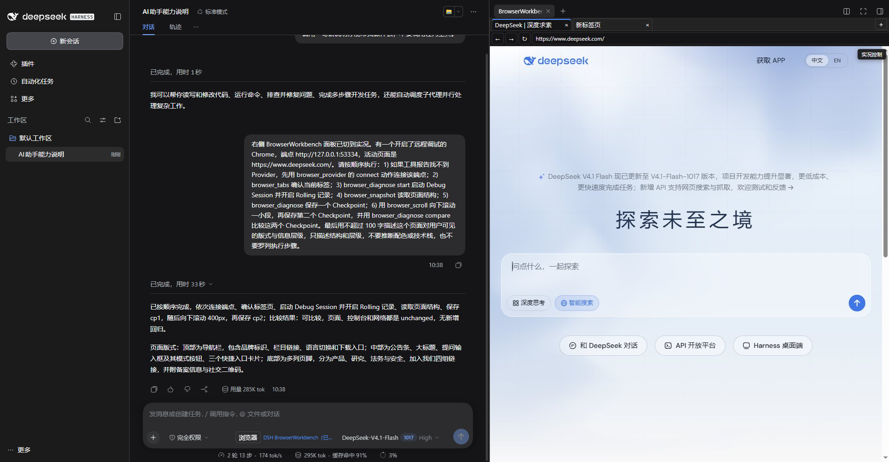
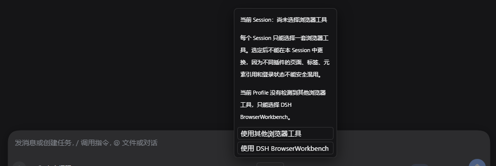
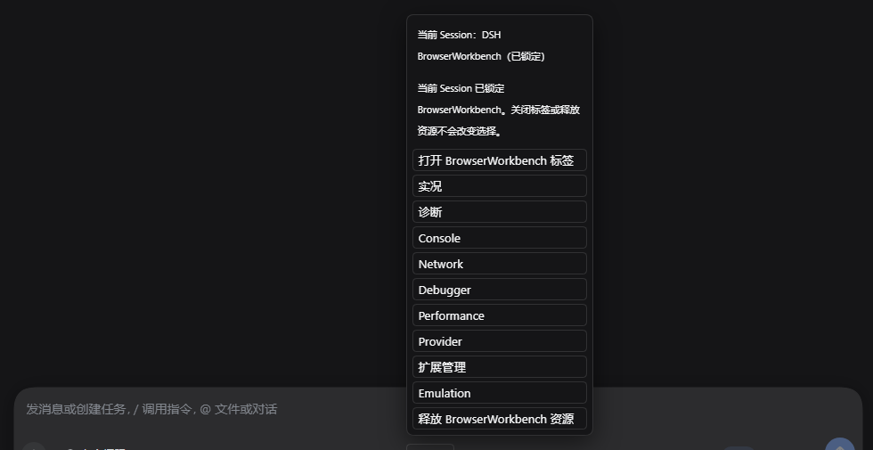
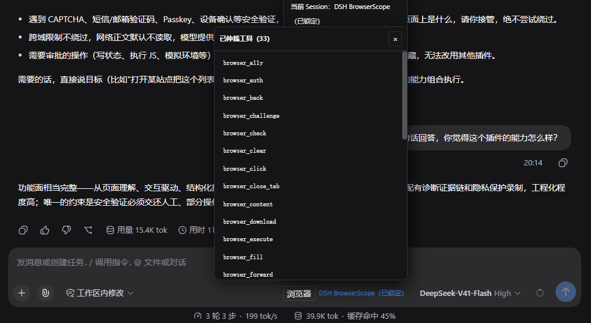
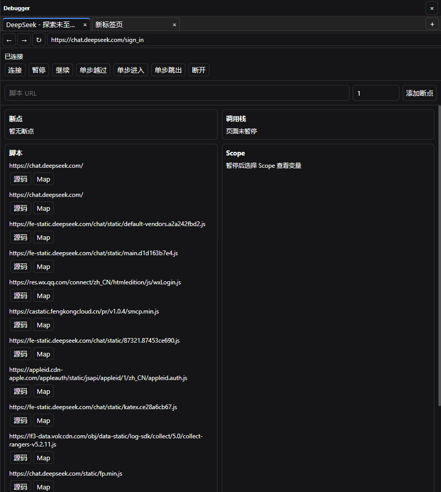
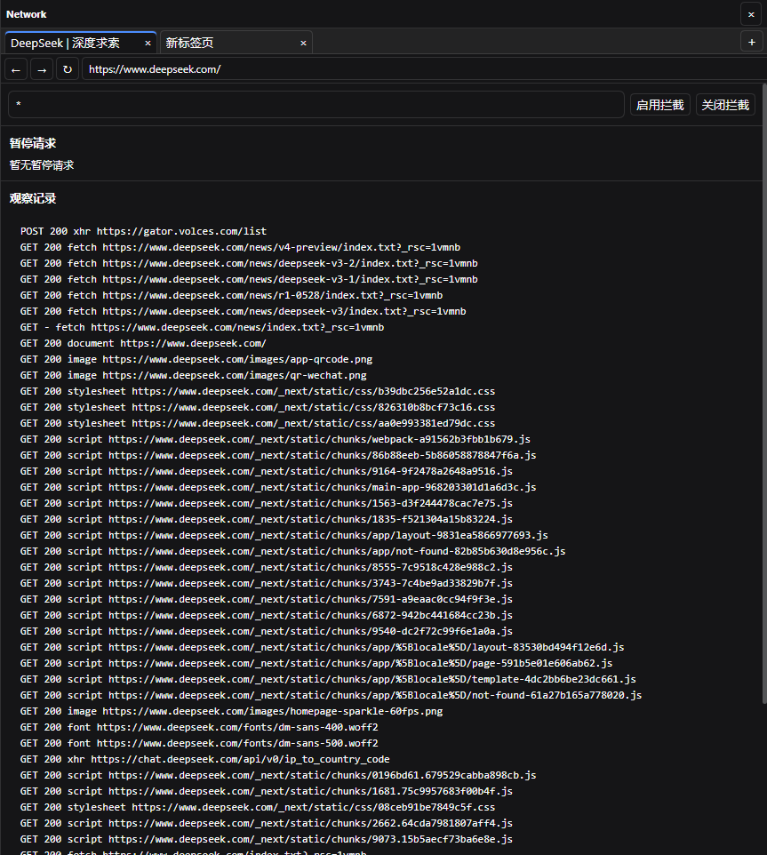
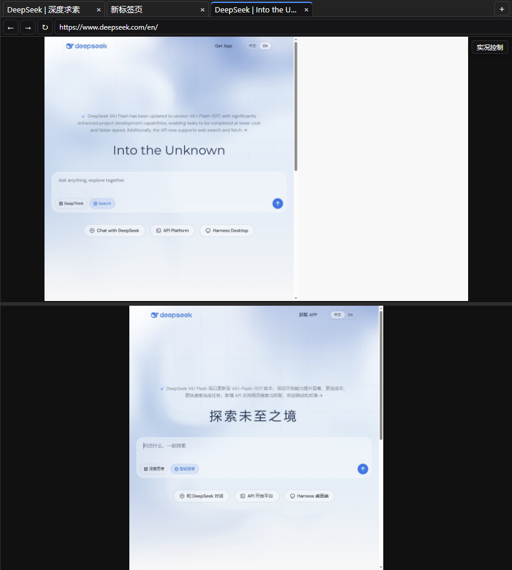
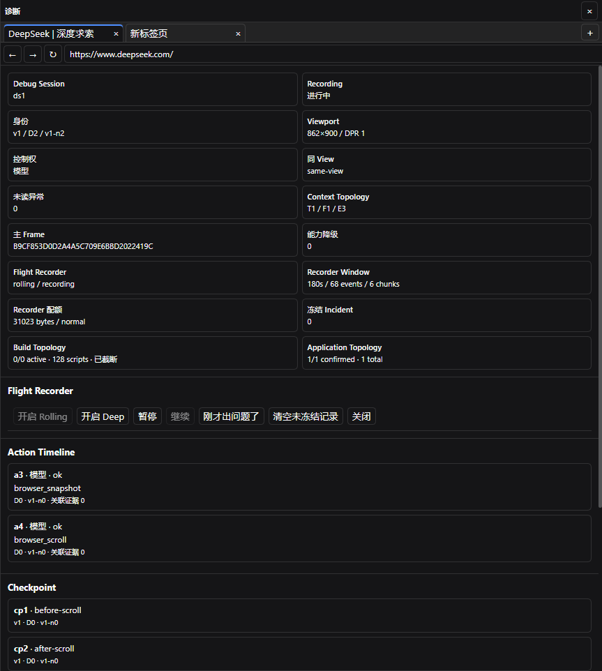
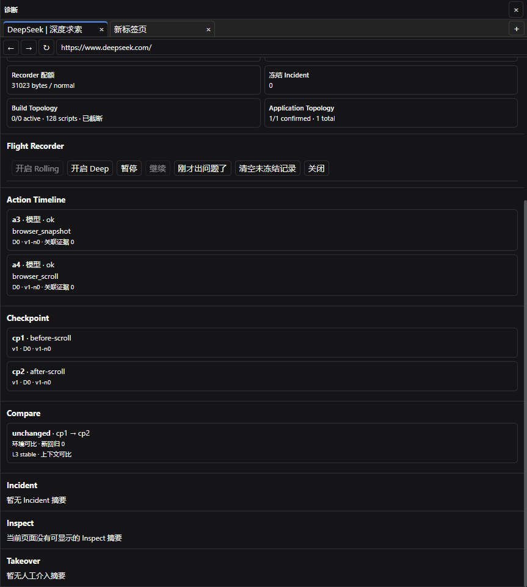
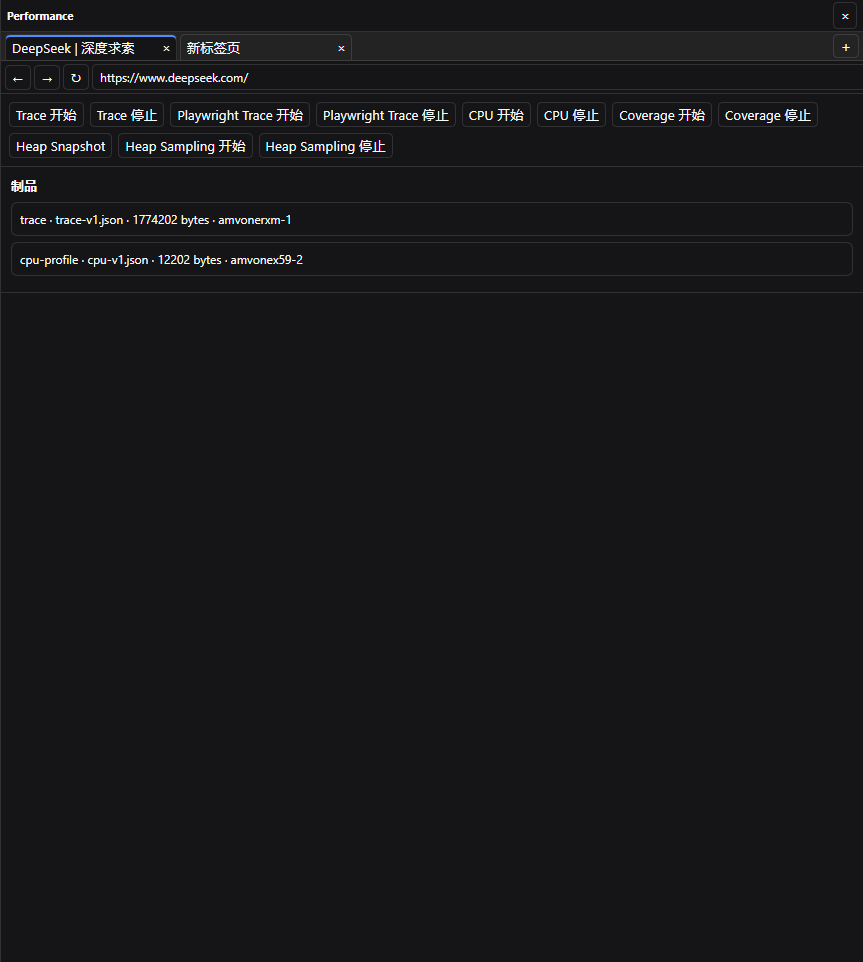

<div align="center">

# DSH BrowserWorkbench

### 把完整 Chromium DevTools 交给 DSH Agent

不只看页面。能点击、能断点、能抓请求、能读 Source Map，还能把现场证据留下。


[源码安装](#安装) · [看图了解](#能力展示) · [30 个工具](#功能介绍) · [验证结果](#验证结果) · [技术细节](./TECHNICAL.md) <br> <br>
当前语言为简体中文 | [English](./README.en.md)

</div>

---

> [!IMPORTANT]
> 这是独立开发的社区插件，不是 DeepSeek 官方发布、维护或背书的插件。它不会修改 DeepSeek Harness 的核心代码。<br>
> 当前版本 `1.0.0-rc8`，**尚未发布到 npm**（见 [PUBLISHING.md](./PUBLISHING.md)），请按下面的[源码安装](#安装)流程使用。<br>
> 项目仍在开发中，遇到 bug 或任何意料外的情况都可以通过 issue 反馈。
>
>> *如果该插件帮上你的忙了，还请点颗星让更多人看见~非常感谢 Thanks♪(･ω･)ﾉ*

## 当前状态

| 项目 | 真实情况 |
| --- | --- |
| 版本 | `1.0.0-rc8`(Release Candidate) |
| 目标宿主 | DSH `0.2.1-rc.2` / `0.2.1-rc.3`(peer 精确固定)，Cordis `~4.0.5`，Schemastery `~3.18.5` |
| npm 状态 | **未发布**。首次发布流程尚未执行，npm 安装方式目前不可用 |
| 仓库内容 | 源码 + 测试 + 文档；**不含** `lib/` 构建产物，也不含 `node_modules`、`.sandbox`、`.npm-cache` |
| 已实测通过 | 严格类型检查、166 个单测、正式构建、30 工具真实 Chromium 回归、独立进程 + 独立 `DSH_HOME` 的七层验证 |
| 待完成 | 全新 DSH Web Profile 的安装/启动/认证/卸载人工验收；npm 首次发布 |
| 未声明兼容 | DSH `0.1.x`(RC7 及更早)、macOS / Linux 实机、任意第三方浏览器插件 |

## 插件简介

前端调试最头疼的是什么？看不到页面结构、抓不到请求细节、断点打不进去、错误只有一句话。Agent 遇到复杂网页问题时更麻烦——只能截个图、描述几句，然后陷入"刷新试试""清缓存看看"的循环。

BrowserWorkbench 在 DSH Web 右侧栏嵌入一个完整的 Chromium 工作台，配备 30 个专门定制的自动化工具。Agent 现在能直接读页面结构、操作元素、查看 Console、追踪请求、下断点、读调用栈、解析 Source Map、分析性能，并把操作前后的完整现场记录下来。从基础的点击滑动，到深度的断点调试和性能瓶颈定位，全在一个 Session 里完成。

**工具面只接受外部 CDP 连接**：Agent 通过 `browser_provider` 连接用户已经开启远程调试的 Chrome 或 Edge，不会浏览、下载或托管新的浏览器；页面、标签和登录状态都留在用户自己的浏览器里。插件内部保留了托管启动（`executablePath`、`headless`、代理）的实现与测试，但当前版本不在工具面暴露，详见[已知边界](#已知边界)。



## 目录

- [当前状态](#当前状态)
- [能力展示](#能力展示)
- [安装](#安装)
- [功能介绍](#功能介绍)
- [目录结构](#目录结构)
- [开发与验证](#开发与验证)
- [已知边界](#已知边界)
- [兼容范围](#兼容范围)
- [使用反馈](#使用反馈)
- [License](#license)

## 能力展示

### 一个窗口，完整调试链路

Agent 对话、真实页面、标签栏、地址栏和调试结果全在 DSH 右侧栏。当页面出现异常时，不用在多个窗口来回切换——直接在原位查看 DOM 结构、Console 输出、Network 请求和脚本堆栈。

**典型排查场景**：页面布局突然错乱。Agent 调用 `browser_snapshot` 读取 DOM 结构，发现某个容器的 `display` 被异步脚本改成了 `none`。接着用 `browser_debugger` 在相关脚本里下断点，配合 Source Map 找到原始代码位置，最终定位到一个状态更新时序问题。

### 首次选择，Session 内保持一致



正式 Session 第一次使用浏览器前，需要选择 BrowserWorkbench 或当前 Profile 中已有的其他浏览器工具。选择前，当前 Session 暂时不向 Agent 暴露浏览器工具。



选择 BrowserWorkbench 后，当前 Session 只使用 BrowserWorkbench；选择其他浏览器工具后，BrowserWorkbench 不会在该 Session 注册工具或创建浏览器资源。选定后不能中途更换，需要换插件时新建 Session。其他 Session 可以独立选择，第三方插件本身不被停止或修改。



释放 BrowserWorkbench 资源只会关闭它自己的页面和调试状态，不会解除当前 Session 的工具选择。DSH 重启或 Agent Scope 替换后，原选择继续保持。

### 线上压缩代码？直接还原



代码被 Webpack 压缩成一行？没关系。连上 CDP Debugger，挂上 Source Map，直接在原始源码里找问题。调用栈、变量作用域、断点位置全都能准确映射回去。

### 请求时序，一清二楚



抓包列表按时间排列，`mode` 和 `generation` 的变化直接标出异步任务的先后顺序。专治状态覆盖、响应迟到这类时序 Bug。

### 双页实况，同时盯梢



两个真实页面，独立画面，独立焦点。做响应式检查时上下排列，跨页面对比时左右排列。

### 保护现场，有据可查



Debug Session 把页面身份、操作时间线、Context Topology 和 Build Identity 打包在一起。



操作前后各存一个 Checkpoint，直接 Compare 生成 Incident 报告。

### 性能问题，无处藏身



CPU 飙高？内存泄漏？用 Trace 看主线程阻塞，用 CPU Profile 找热点函数，用 Heap Snapshot 查对象保留。所有大文件自动存入 Session 隔离的 Artifact Store，不会撑爆 AI 的上下文。

## 安装

需要 Node.js `^22.19.0` 或 `>=24.0.0`，pnpm，以及一个可以正常启动的 DSH Web Profile。

### 从源码构建安装（当前唯一可靠方式）

仓库不包含 `lib/` 构建产物，所以必须先构建：

```powershell
git clone https://github.com/MaxJue/dsh-browser-workbench.git
cd dsh-browser-workbench
pnpm install --frozen-lockfile --ignore-scripts
npm run build        # 产出 lib/index.mjs、lib/index.d.mts、lib/client.js
```

打包并装进 Profile：

```powershell
npm pack             # 生成 dsh-browser-workbench-1.0.0-rc8.tgz
dsh plugin --profile web add ./dsh-browser-workbench-1.0.0-rc8.tgz --ignore-scripts --config.auto-install-peers=false
```

也可以直接把仓库目录加进 Profile（`dsh plugin --profile web add <仓库绝对路径>`）；后续改代码只需重新 `npm run build`，不必重新安装。

> `dsh plugin --profile web add dsh-browser-workbench@1.0.0-rc8` 这种 npm 方式在你完成首次发布前会失败，因为包还没上 Registry。

在 Profile 的 `cordis.patch.yml` 中启用：

```yaml
- insert:
    - id: browser-tools
      name: dsh-browser-workbench
```

启动 Chrome 并开启远程调试（示例：`chrome.exe --remote-debugging-port=9222`），再启动 DSH Web。新建 Session 后打开右侧 BrowserWorkbench 面板，按"连接现有 Chrome"中的三步操作绑定 `http://127.0.0.1:9222`。连接失败时只需检查 Chrome 进程、启动参数和端口。

从历史包 `dsh-browser-tools` 升级时，先移除旧包。保留 `id: browser-tools` 和 `$DSH_HOME/browser-tools`。两个包不要同时安装在同一个 Profile 中。

## 功能介绍

### 浏览与操作

| 功能 | 说明 | 工具 |
| --- | --- | --- |
| 标签管理 | 查看、创建、切换和关闭标签 | `browser_tabs` |
| 页面导航 | 打开 URL、后退、前进和刷新 | `browser_navigate`, `browser_navigate_back` |
| 读取页面 | 读取页面结构、元素位置、属性和查询结果 | `browser_snapshot`, `browser_get_attribute`, `browser_query` |
| 操作页面 | 点击、悬停、滚动、输入文字、按键、选择下拉项和等待变化 | `browser_click`, `browser_hover`, `browser_scroll`, `browser_type`, `browser_press_key`, `browser_select_option`, `browser_wait_for` |
| 处理弹窗 | 接受或拒绝页面弹窗，并填写 Prompt | `browser_handle_dialog` |
| 执行脚本 | 在页面或指定元素中执行 JavaScript | `browser_evaluate` |
| 截图 | 保存当前页面画面 | `browser_take_screenshot` |
| 上传下载 | 上传本地文件，捕获并保存下载文件 | `browser_upload_file`, `browser_download` |

### Console 与请求

| 功能 | 说明 | 工具 |
| --- | --- | --- |
| 读取 Console | 查看日志、警告、错误和重复消息 | `browser_console_messages` |
| 查看请求 | 查看请求地址、方法、状态、资源类型和发生顺序 | `browser_network_requests` |
| 查看请求内容 | 读取请求和响应 Body | `browser_network_requests` |
| 暂停请求 | 在请求或响应阶段拦截流量 | `browser_network_control` |
| 放行或终止 | 对被暂停的请求执行 Continue 或 Abort | `browser_network_control` |
| 模拟响应 | 返回自定义状态、Header 和 Body | `browser_network_control` |
| 重发请求 | 重放已经发生的请求 | `browser_network_control` |
| 自动恢复 | 拦截超时后自动放行，避免页面卡住 | `browser_network_control` |

### 断点与源码

| 功能 | 说明 | 工具 |
| --- | --- | --- |
| 连接调试器 | 连接当前页面的 CDP Debugger | `browser_debugger` |
| 断点控制 | 设置断点、暂停、继续、单步进入、单步跳过和单步跳出 | `browser_debugger` |
| 查看调用栈 | 查看函数调用顺序、脚本位置和暂停原因 | `browser_debugger` |
| 查看变量 | 查看 Local、Closure 和 Global 中的变量 | `browser_debugger` |
| 读取脚本 | 查看页面加载的脚本和运行时源码 | `browser_debugger` |
| 还原源码 | 把压缩代码位置映射回原始文件和行列 | `browser_debugger`, `browser_diagnose` |
| 识别构建版本 | 记录脚本内容和构建身份，避免读错版本 | `browser_diagnose` |
| 区分执行环境 | 区分主世界、隔离世界和暂停帧 | `browser_debugger`, `browser_diagnose` |

### 性能与诊断

| 功能 | 说明 | 工具 |
| --- | --- | --- |
| 记录 Trace | 记录页面主线程、网络和渲染过程 | `browser_profile` |
| 记录操作过程 | 保存页面动作、Snapshot、请求和时间线 | `browser_profile` |
| 分析 CPU | 找到耗 CPU 的函数和调用路径 | `browser_profile` |
| 统计覆盖 | 查看 JavaScript 和 CSS 使用情况 | `browser_profile` |
| 查看内存 | 保存 Heap Snapshot，调查对象保留问题 | `browser_profile` |
| 观察内存增长 | 使用 Heap Sampling 观察长任务中的分配热点 | `browser_profile` |
| 建立诊断会话 | 把页面、操作、上下文和构建信息放在一起 | `browser_diagnose` |
| 保存 Checkpoint | 记录操作前后的页面和身份状态 | `browser_diagnose` |
| 对比变化 | 比较两个 Checkpoint，标出变化和回退 | `browser_diagnose` |
| 生成 Incident | 汇总动作、Console、请求、身份和对比结果 | `browser_diagnose` |
| 记录关键事件 | 按 Off、Rolling、Deep、Metadata-only 和 Incident 模式记录 | `browser_diagnose` |
| 保存大文件 | 把 Trace、Profile、Heap 和报告保存到 Session 目录 | `browser_profile`, `browser_diagnose` |

### 实况与人工接管

| 功能 | 说明 | 工具 |
| --- | --- | --- |
| 查看实况 | 在右侧栏持续查看当前页面 | `browser_live_view` |
| 自动调整尺寸 | 页面跟随面板尺寸变化，避免输入坐标错乱 | `browser_live_view`, `browser_emulate` |
| 上下双页 | 同时查看两个页面 | `browser_split_view` |
| 左右双页 | 横向查看两个页面 | `browser_split_view` |
| 人工点击 | 用鼠标直接操作页面 | `browser_takeover` |
| 人工输入 | 用键盘输入文本和组合键 | `browser_takeover` |
| 中文输入 | 正常输入中文，不会拆成错误按键 | `browser_takeover` |
| 粘贴内容 | 使用最终粘贴事件，不读取剪贴板历史 | `browser_takeover` |
| 人工接管 | 暂时接管页面，完成后把控制权还给 Agent | `browser_takeover` |
| 防止旧输入 | 页面尺寸或画面变化后，拒绝过期坐标输入 | `browser_takeover` |

### 扩展与浏览器环境

| 功能 | 说明 | 工具 |
| --- | --- | --- |
| 扩展管理边界 | 外部 CDP 模式下 `browser_extensions` 是只读兼容端点，不读取、不安装、不启停浏览器扩展 | `browser_extensions` |
| 连接浏览器 | 连接已用远程调试启动的 Chrome/Edge | `browser_provider` |
| 保留浏览器状态 | Cookie、缓存、权限和扩展状态由用户浏览器保留 | `browser_provider` |
| 断开连接 | 只释放 DSH 的 CDP 连接，不关闭用户浏览器 | `browser_provider` |
| 模拟设备 | 设置 Viewport、设备、地区、时区、网络、CPU 和离线状态 | `browser_emulate` |
| 模拟权限 | 控制页面权限 | `browser_emulate` |

### Session 控制

| 功能 | 说明 |
| --- | --- |
| 首次选择 | 正式 Session 第一次使用浏览器前，选择 BrowserWorkbench 或其他浏览器工具 |
| Session 锁定 | 选择后不能在同一个 Session 中更换浏览器插件；需要更换时新建 Session |
| 选择前保护 | 尚未选择时，当前 Session 暂时不向 Agent 暴露识别到的浏览器工具 |
| 按需注册 | 选择 BrowserWorkbench 后，只在当前 Session 注册 30 个工具 |
| 全局模式 | `toolRegistrationMode: global` 时独占 Profile 全局注册工具 |
| 安全降级 | 全局模式发现已有浏览器工具时，自动改为按 Session 选择 |
| 工具替换 | 选择 BrowserWorkbench 后，只在当前 Session 中遮蔽同名工具并隐藏第三方独有浏览器工具 |
| 释放资源 | 关闭 BrowserWorkbench 页面和调试状态，但不解除该 Session 的 BrowserWorkbench 锁定 |
| 重启恢复 | DSH 重启或 Agent Scope 替换后，继续恢复该 Session 已保存的选择 |
| 隔离 Session | 一个 Session 的选择、标签和调试状态不会改变其他 Session |
| 共享网站状态 | Cookie、LocalStorage、IndexedDB、Cache Storage、HTTP 缓存、Service Worker 和权限可以跨 Session 共享 |
| 隔离页面状态 | Page、View、标签、Popup、活动页和双页焦点按 Session 隔离 |
| 隔离调试状态 | Debugger、请求拦截、Ref、Snapshot 和实况画面按 Session 隔离 |
| 隔离文件 | Artifact、Takeover 和 Controller 状态按 Session 隔离 |
| 跟踪页面来源 | `window.open()` 页面继承正确 Owner；无法确认来源的页面不会暴露给其他 Session |
| 恢复页面布局 | 浏览器 Context 重建后，恢复各 Session 的地址、活动标签和双页布局 |

## 目录结构

```
src/
├── application/   工具定义（30 个 browser_*）、配置 schema、安全策略、工具元数据
├── cdp/           CDP 会话与协议级事件（debugger / fetch / screencast / profile / script）
├── client/        React 19 面板 UI：components、hooks、utils、panel-controller
├── compat/        DSH 版本兼容层、消息与 RPC 分发
├── controller/    Session 级控制器仲裁（browser-controller）
├── diagnostics/   取证：Flight Recorder、Context/Build Identity、Incident、Source Map
├── domain/        纯协议契约：types、protocol、errors、policy
├── extensions/    CRX3 解包、扩展注册表、扩展 popup
├── input/         人工接管、键鼠/指针手势、输入观察
├── page/          导航、网络录制与拦截、对话框、页面诊断
├── provider/      外部 CDP 连接、托管启动配置、持久化 Profile、Artifact 存储
├── runtime/       编排层（每个文件都控制在数百行内）
├── session/       Session Key、独占任务队列、标签恢复
└── view/          Viewport、自适应重排、分屏、screencast 同步

tests/             与 src/ 结构一一对应
scripts/verify/    e2e 验证脚本与本地夹具站点
```

源码规模：`src/` 138 个文件约 1.63 万行；`tests/` 54 个文件、166 个用例。Architecture 约束见 [AGENTS.md](./AGENTS.md) 与 [DIRECTORY_SPECIFICATION.md](./DIRECTORY_SPECIFICATION.md)。

## 开发与验证

提交前必须通过三道静态门禁：

```powershell
npm run typecheck    # tsc --noEmit，0 错误
npm test             # 166 个单测全部通过
npm run build        # tsdown，产出 lib/index.mjs 与 lib/client.js
```

需要真实浏览器时，再按需单独跑对应层级（**不会隐式下载 Chromium**，需要自己提供已就绪的浏览器与本地夹具站点）：

```powershell
npm run verify:tools       # Runtime 层：30 个 browser_* 工具的 145 项断言（真实 Chrome + 本地夹具站点）
npm run verify:extensions  # 扩展层：MV3 本地安装、注册表落盘、启停卸载、popup 与非法输入（19 项）
npm run verify:managed     # 托管层：executablePath/headless、三种代理、HTTPS CONNECT、离线安装（16 项）
npm run verify:sandbox     # 起独立 DSH_HOME 实例，打印带 token 的地址
npm run verify:instance    # 实例层：Client bundle、composer 控件、认证 RPC 往返（10 项）
npm run verify:panel       # 面板层：正式 Session → 控制器激活 → 9 视图 → Provider → 实况 → 人工接管（33 项）
npm run verify:config      # 配置层：13 项配置的运行时时真实效果
npm run verify:rpc         # RPC/持久化层：认证边界、信封契约、控制器选择跨刷新（16 项）
npm run verify:persist -- --phase=prepare   # 认领控制器并记录 marker
npm run verify:persist -- --phase=verify    # 重启 Host 后复核（需要新的 token）
```

七层验证的完整记录、本轮修掉的 7 个真实缺陷，以及不可达路径的说明，见 [VALIDATION.md](./VALIDATION.md) 第十四、十五节。

### 验证结果

| 层级 | 入口 | 结果 |
| --- | --- | --- |
| 静态门禁 | `typecheck` / `test` / `build` | 0 错误 / 166 通过 / 构建成功 |
| Runtime | `verify:tools` | 145/145 |
| 实例 | `verify:instance` | 10/10 |
| 真实 UI 面板 | `verify:panel` | 33/33 |
| 扩展 | `verify:extensions` | 19/19 |
| 托管启动 + 代理/HTTPS | `verify:managed` | 16/16 |
| 配置 | `verify:config` | 13/13 |
| RPC | `verify:rpc` | 16/16 |
| 持久化 | `verify:persist` | prepare 7/7 + verify 5/5 |

Runtime 层使用真实 Chrome（`155.0.8059.85`）经 `external-cdp` 连接本地夹具站点。需要提醒的是：Recorder 保留窗口的 30 分钟结论来自**虚拟时间模拟**，只证明保留与淘汰算法边界，不等同于真实墙钟 30 分钟稳定性压测。

## 已知边界

这些是当前版本真实存在、且有意保留的行为，不是待修的 TODO：

- **托管启动不在工具面暴露**：`browser_provider` 只接受 `external-cdp`，`providerBinding` 只有 `disconnected` / `external-cdp` 两个写入点。`executablePath`、`headless`、代理等托管配置只在 runtime 受保护方法和 `verify:managed` 中生效并验证。
- **托管下载元数据落后**：`src/provider/chromium-manager.ts` 的 `KNOWN_ARCHIVES` 只登记了 `149.0.7827.55`，而 playwright-core 1.64.1 期望 `156.0.8078.4`，缺元数据时会 fail-closed 拒绝下载。这是刻意的完整性策略，不是 bug。
- **`browser_live_view adaptive` 依赖面板**：面板没打开时没有可用尺寸上报，返回可恢复的 `ADAPTIVE_SIZE_UNAVAILABLE`。
- **扩展只读**：外部 CDP 模式下 `browser_extensions` 是历史注册表的只读兼容端点；扩展的安装/启停需要直接操作已连接的浏览器。
- **`subagentInteractive` 默认 `false`**：委派子会话调用导航、点击、对话框等交互类工具会被拒绝，顶层会话按 permission preset 决定 allow/ask。
- **不覆盖的范围**：DRM、Native Messaging、Manifest V2、CAPTCHA/验证码、Passkey/WebAuthn、任意站点的反自动化策略，以及被调试应用自身的业务正确性。

## 兼容范围

版本 `1.0.0-rc8` 的目标宿主是 DSH `0.2.1-rc.2` / `0.2.1-rc.3`，要求 Cordis `~4.0.5`、Schemastery `~3.18.5`、Node `^22.19.0 || >=24.0.0`。RC7 及更早版本不支持 DSH `0.2.x`，`0.1.x` 时期的验证结论不适用。

已在 Windows + Node 22.x + pnpm 11.x + 真实 Chrome 上实测；macOS、Linux 与其他 Chromium 分支未做实机验证。

候选状态以外部 candidate-identity 文件和 tarball 摘要为准；本仓库的描述不能单独证明某个版本已完成 Git Tag、GitHub Release 或 npm 发布。

## 技术细节

完整配置、工具注册模式、状态模型、安全边界、内部标识和工具清单见 [TECHNICAL.md](./TECHNICAL.md)。

## 使用反馈

遇到缺陷、兼容问题或有新功能建议，请提交 [GitHub Issue](https://github.com/MaxJue/dsh-browser-workbench/issues)。带上 DSH 版本、BrowserWorkbench 版本、操作系统、Node.js 版本和同时加载的浏览器插件，可以更快定位问题。

安全漏洞请按 [安全策略](./SECURITY.md) 私密报告。不要把凭据、Cookie、会话数据或未脱敏日志放进公开 Issue。

## License

[MIT](./LICENSE)
